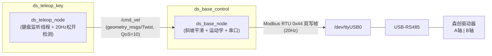

# DS Diff-Car —— 两轮差速小车遥控系统 开发指南

[](https://docs.ros.org/en/jazzy/)
[](https://www.raspberrypi.com/)
[](https://ubuntu.com/)
[](LICENSE)

> **一句话简介**:纯 Python 实现的 ROS 2 差速底盘控制栈 —— 键盘遥控 → 速度平滑 → 差速解算 → Modbus RTU 直控电机 RPM,全链路实机验证,不依赖任何厂商黑盒驱动。

---

## 目录

- [第一章:项目概述与系统架构](#第一章项目概述与系统架构)
- [第二章:核心硬件与接线指南](#第二章核心硬件与接线指南)
- [第三章:运动学解算与协议揭秘](#第三章运动学解算与协议揭秘)
- [第四章:功能包架构详述](#第四章功能包架构详述)
- [第五章:编译、运行与故障树排查](#第五章编译运行与故障树排查)
- [第六章:下一步演进计划](#第六章下一步演进计划)

---

## 第一章:项目概述与系统架构

### 1.1 为什么重造这个轮子

市面上的"树莓派 + 差速底盘"方案,大多依赖厂商提供的黑盒驱动脚本。本项目在开发初期也踩过这个坑:驱动器自带的 `0xEA` 差速协议是一个**不透明且语义混乱的封装层**——同样的两个字节数据,在文档、实机、诊断工具三方的表现互相对不上,我们甚至专门写了一个 `test_0xea.py` 诊断工具逐字段爆破验证,最终确认其语义不可靠。

本项目最终做出的关键技术决策:

| 决策 | 黑盒方案(已抛弃) | 本项目方案 |
|---|---|---|
| 控制指令 | 厂商 `0xEA` 差速协议(语义不透明) | **`0x44` 双写指令直控双轴 RPM** |
| 电机镜像 | 依赖驱动器内部处理 | **Python 层显式补偿**(`A_AXIS_INVERT` 等三个开关) |
| 可控性 | 出问题只能猜 | 每一帧、每一个字段都由我们自己构造 |
| 可移植性 | 绑定特定固件 | 协议字典集中管理,换驱动器只改一处 |

> [!IMPORTANT]
> **"原地打转"痛点复盘**:该驱动器的两个电机出厂存在物理镜像反装(A 轴正向与 B 轴正向在机械上相反)。若在协议层照抄"左右轮等速"的天真假设,两轮实际转向相反,小车只会原地打转。本项目的解法是把方向补偿上移到 Python 层——`A_AXIS_INVERT / LINE_INVERT / ANG_INVERT` 三个显式开关,配合实测校准,彻底根治。**硬件缺陷在软件层显式声明,好过在黑暗中互相掩盖。**

### 1.2 系统数据流

```
 ┌──────────┐   stdin(cbreak)  ┌─────────────────┐   /cmd_vel        ┌──────────────────────┐
 │  你的键盘 │ ───────────────▶ │  ds_teleop_node │ ────────────────▶ │     ds_base_node     │
 │ (SSH可用) │   非阻塞监听      │  (ds_teleop_key) │ geometry_msgs/   │   (ds_base_control)  │
 └──────────┘                  └─────────────────┘      Twist        └──────────┬───────────┘
                                                                                │ ① Velocity Smoother
                                                                                │ ② 差速运动学解算
                                                                                │ ③ Modbus RTU 0x44 组帧
                                                                                ▼
                                                                   ┌──────────────────────┐
                                                                   │ USB-RS485 (/dev/ttyUSB0) │
                                                                   │ 115200 8N1            │
                                                                   └──────────┬───────────┘
                                                                              ▼
                                                                   ┌──────────────────────┐
                                                                   │ 森创 DS/RS 二合一驱动器 │
                                                                   │      A 轴   B 轴      │
                                                                   └──────────────────────┘
```

### 1.3 ROS 2 计算图 (Node Graph)



等价的命令行验证:

```bash
ros2 node list        # /ds_base_node  /ds_teleop_node
ros2 topic list       # /cmd_vel
ros2 topic info /cmd_vel   # Type: geometry_msgs/msg/Twist
```

### 1.4 设计原则

1. **状态分离**:`target`(期望速度)与 `current`(实际下发速度)严格解耦,话题回调只写 target,串口定时器只读 current——这是平滑与安全的基石。
2. **协议字典集中化**:所有魔法字节(使能/失能/包头)收敛为模块级常量,CRC 一律现算不硬编码,换驱动器时只动一处。
3. **安全分层**:键盘层(松开停车)→ 通信层(看门狗刹停)→ 退出层(0 速帧 + 失能帧),三层防御互为兜底。
4. **可实测性**:全链路可在虚拟串口(pty)上做帧级断言,不需要真车也能回归测试。

---

## 第二章:核心硬件与接线指南

### 2.1 硬件清单 (BOM)

| # | 物料 | 规格/型号 | 数量 | 备注 |
|---|---|---|---|---|
| 1 | 主控 | 树莓派 4B(建议 ≥4GB) | 1 | Ubuntu 24.04 + ROS 2 Jazzy |
| 2 | 串口转换 | USB 转 RS485(FTDI/CH340 均可) | 1 | 枚举为 `/dev/ttyUSB0` |
| 3 | 驱动器 | 森创 DS/RS 二合一伺服驱动器 | 1 | Modbus RTU 扩展协议,从站地址 0x01 |
| 4 | 电机 | 直流伺服电机 ×2 | 2 | 分别接驱动器 A、B 轴 |
| 5 | 电源 | 锂电池组(按电机电压选型) | 1 | **动力电与树莓派供电隔离** |
| 6 | 线材 | 双绞线/屏蔽线若干 | — | RS485 总线走线,建议双绞 |

### 2.2 接线拓扑

```
 树莓派 4B                        USB-RS485            森创 DS/RS 驱动器
┌────────────┐   USB   ┌──────────────┐    A ──────────▶ A(+)
│            │ ◀─────▶ │              │    B ──────────▶ B(-)
│            │         │              │    GND ────────▶ GND  ★ 必须共地!
└────────────┘         └──────────────┘
     ▲
     │ 5V/3A 独立供电(或优质电源 bank)
```

### 2.3 避坑指南(血泪经验)

> [!WARNING]
> **RS485 三大纪律,违反任何一条都会出现"时通时断"的诡异现象:**

1. **A/B 绝不能接反**。RS485 是差分信号,A/B 颠倒会导致完全无法通信(或大量 CRC 错包)。若怀疑接反,直接对调 A/B 再试,这是零成本实验。
2. **必须与驱动器共地(GND)**。USB 转换器的 GND 与驱动器电源 GND 之间如果没有公共参考地,差分电平的共模电压会漂移——表现为偶发丢包、CRC 错误、低速时好时坏。**这不是玄学,是物理。**
3. **动力电与逻辑电分离**。电机瞬间电流可达安培级,与树莓派共用电源会造成电压跌落 → 树莓派重启/USB 掉线。树莓派用独立 5V/3A 供电,并且上电顺序建议:先驱动器,后树莓派。

> [!TIP]
> **串口权限一次性配置**(免得每次 `chmod`):
>
> ```bash
> sudo usermod -aG dialout $USER   # 把当前用户加入 dialout 组
> # 然后注销并重新登录(或重启)使组生效
> groups                            # 验证输出中包含 dialout
> ```
>
> 临时方案(拔插后失效):`sudo chmod 666 /dev/ttyUSB0`

### 2.4 串口自检

```bash
ls -la /dev/ttyUSB*               # 确认设备存在
udevadm info /dev/ttyUSB0 | grep ID_MODEL   # 确认是USB转串口而非其他设备
python3 -c "import serial; s=serial.Serial('/dev/ttyUSB0',115200); print('OK'); s.close()"
```

---

## 第三章:运动学解算与协议揭秘

### 3.1 差速运动学模型

两轮差速底盘的平面运动由线速度 $V$(m/s)与角速度 $\omega$(rad/s)唯一确定。已知轮距 $L$(两轮接地点间距)与轮径 $D$:

**左轮线速度** —— 位于转弯圆内侧,比车速慢:

$$V_L = V - \omega \times \frac{L}{2}$$

**右轮线速度** —— 位于转弯圆外侧,比车速快:

$$V_R = V + \omega \times \frac{L}{2}$$

**转速换算**(线速度 → 每分钟转数,轮子每转一圈前进 $\pi D$):

$$RPM = \frac{V}{\pi \cdot D} \times 60$$

**本项目参数**:

| 参数 | 符号 | 数值 |
|---|---|---|
| 轮距 | $L$ | 315 mm |
| 轮径 | $D$ | 168 mm |
| 半轮距 | $L/2$ | 157.5 mm |

**算例**:令 $V = 0.2\ \mathrm{m/s},\ \omega = 0.5\ \mathrm{rad/s}$,则
$V_L = 200 - 0.5 \times 157.5 = 121.25\ \mathrm{mm/s}$,$V_R = 278.75\ \mathrm{mm/s}$;
换算 $RPM_L = 121.25 / (\pi \times 168) \times 60 \approx 13.8$,$RPM_R \approx 31.7$——与代码实测下发帧完全一致。

> [!NOTE]
> **单位陷阱警示**:代码内部统一用 mm/s 与 mrad/s(整数化便于观察),解算时角速度项必须 ÷1000 还原量纲。若照字面直接用 `mrad/s × mm`,转向差速项会被放大 1000 倍——这是本项目开发中真实踩过并修掉的坑。

**方向补偿链**(自上而下,全部在 Python 层完成):

```
/cmd_vel (ROS 右手系: +x 前, +z 逆时针)
   │ ×1000 单位转换
   ▼
LINE_INVERT  → V 取反   (整车前后装反时)
ANG_INVERT   → ω 取反   (整车左右装反时)
   ▼
差速解算 → V_L, V_R → RPM_L, RPM_R
   ▼
A_AXIS_INVERT → RPM_A = -RPM_L   (A 轴电机出厂镜像反装)
   ▼
打包发送 [RPM_A, RPM_B]
```

### 3.2 0x44 双写指令报文结构

`0x44` 是驱动器扩展协议中的**双寄存器写**功能码,一帧同时刷新 A、B 两轴的目标转速。完整 12 字节帧:

```
┌──────┬──────┬────────────────┬────────────┬────────────┬─────────┬─────────┐
│ 0x01 │ 0x44 │ 0x23 0x18      │ 0x33 0x18  │ RPM_A      │ RPM_B   │ CRC16   │
│ 从站  │ 功能  │ A轴寄存器起始地址│ B轴寄存器   │ H  L       │ H  L    │ L  H    │
│ 地址  │ 码   │ (固定包头前半)   │ 地址(包头后半)│ 大端有符号16 │ 大端有符号│ 低前高后 │
└──────┴──────┴────────────────┴────────────┴────────────┴─────────┴─────────┘
  byte0  byte1   byte2  byte3     byte4  byte5   byte6 byte7  byte8 byte9  byte10 byte11
```

即: `[0x01, 0x44, 0x23, 0x18, 0x33, 0x18, RPM_A_H, RPM_A_L, RPM_B_H, RPM_B_L, CRC_L, CRC_H]`

**字段详解:**

| 字段 | 字节 | 说明 |
|---|---|---|
| 从站地址 | byte0 | 固定 `0x01`(驱动器出厂地址) |
| 功能码 | byte1 | `0x44` 双写(一次写两轴) |
| 包头 | byte2~5 | `23 18 33 18` = A/B 轴寄存器地址组合,协议约定固定值 |
| A 轴 RPM | byte6~7 | **大端**(高字节在前)**有符号 16 位补码**,负数即反转 |
| B 轴 RPM | byte8~9 | 同上 |
| CRC-16 | byte10~11 | **低字节在前**,对 byte0~byte9 计算 |

**打包逻辑(Python 视角)**——代码中的两个 `struct` 就是全部秘密:

```python
payload = HEADER                                  # bytes([0x01,0x44,0x23,0x18,0x33,0x18])
        + struct.pack('>h', int(round(rpm_a)))    # '>h': 大端(big-endian) 有符号16位
        + struct.pack('>h', int(round(rpm_b)))    # 负数自动按补码编码, 如 -57 -> 0xFFC7
crc     = crc16_modbus(payload)
frame   = payload + struct.pack('<H', crc)        # '<H': 小端(低字节在前) 无符号16位
```

例:A 轴 -57 RPM → 补码 `0xFFC7` → 大端拆分 `FF C7`;CRC 若为 `0x3475` → 低前高后 `75 34`。

### 3.3 CRC-16/MODBUS 校验

```python
def crc16_modbus(data: bytes) -> int:
    """CRC-16/MODBUS: 初始值0xFFFF, 多项式0xA001反射, 发送时低字节在前."""
    crc = 0xFFFF
    for byte in data:
        crc ^= byte
        for _ in range(8):
            crc = (crc >> 1) ^ 0xA001 if crc & 1 else crc >> 1
    return crc
```

**协议验证记录**(本项目实测,逐字节核算):

| 帧 | 载荷(byte0~9) | 计算值 | 字典值 | 结论 |
|---|---|---|---|---|
| 使能 | `01 44 21 00 31 00 00 01 00 01` | `3475` → `75 34` | `75 34` | ✅ 吻合 |
| 失能 | `01 44 21 00 31 00 00 00 00 00` | `34E5` → `E5 34` | `E5 34` | ✅ 吻合 |

> [!TIP]
> 因此代码**不硬编码任何 CRC**,使能/失能/速度帧统一走 `crc16_modbus()` 现算。协议字典只保留语义载荷,校验交给算法——这是防"手抄字节错一位"这类低级错误的工程手段。

### 3.4 生命周期帧时序

```
节点启动:  使能帧 ──▶ (20Hz 速度帧流, 全程不断流)
节点退出:  0 RPM 帧 ──▶ 失能帧 ──▶ 关闭串口     ( destroy_node 中顺序保证)
看门狗触发: target 清零 ──▶ 速度帧流平滑衰减至 0  (不断流, 不失能)
```

---

## 第四章:功能包架构详述

### 4.1 `ds_base_control` —— 底盘控制节点

**职责边界**:订阅 `/cmd_vel` → 平滑 → 解算 → 组帧 → 串口。不关心速度从哪来(键盘/导航/手柄皆可),是纯粹的"底层执行器抽象"。

#### 亮点一:软件加减速斜坡 (Velocity Smoother)

**问题**:键盘遥控天然是阶跃信号——速度瞬间 0→0.5 m/s、松手瞬间归 0。直接透传给驱动器,起步/刹车瞬间电机电流冲击巨大,机械传动件撞击、整车"点头"。

**解法**:把"期望"与"执行"分离,让执行值以受加速度约束的斜坡追踪期望:

$$\text{step} = a_{max} \times \Delta t, \qquad v_{k+1} = \begin{cases} v_{target} & |v_{target} - v_k| \le \text{step} \\ v_k + \text{sign}(\Delta) \cdot \text{step} & \text{otherwise} \end{cases}$$

- 20Hz 定时器中,`current_v/current_w` 每帧最多变化 `MAX_ACCEL × dt = 800 × 0.05 = 40 mm/s`(角速度同理 100 mrad/s);
- 误差小于一步时直接贴齐,**避免最后一帧永远追不上的极限环抖动**;
- 参数集中在代码头部,调参指南:

| 现象 | 调整 |
|---|---|
| 起步仍有点冲 | `MAX_ACCEL_V` 降到 400~600 |
| 起步太肉、遥控迟钝 | `MAX_ACCEL_V` 升到 1200~1500 |
| 转向"甩头" | `MAX_ACCEL_W` 降到 1000~1500 |
| 转向响应慢 | `MAX_ACCEL_W` 升到 3000 |

> 实测数据:阶跃 0.5 m/s,A 轴 RPM 以每帧恒定 4.5 RPM 单调爬升至 57(理论 56.8),刹停 0.45s = 350/800,与模型精确吻合。

#### 亮点二:0.5s 看门狗超时保护

- `/cmd_vel` 是"无心跳即失联"的隐式约定;遥控节点崩溃、SSH 断连、无线掉包,都会让指令流中断。
- 看门狗每帧检查 `now - last_cmd_time > 0.5s`,超时则**只把 target 归零**——current 走正常斜坡衰减,小车表现为**按 `MAX_ACCEL` 减速度的平滑刹停**,而非急刹。
- 三层退出/安全链互为兜底:键盘层(松开 0.2s 停车)→ 通信层(看门狗 0.5s)→ 退出层(0 速帧 + 失能帧 + 关串口)。

#### 其他工程细节

- 方向补偿三开关 + 参数化串口(`--ros-args -p port:=/dev/ttyUSB0`);
- `destroy_node` 中先 `timer.cancel()` 再清理串口,消除退出瞬间的写句柄竞态;
- CRC 全部现算;`colcon test`(flake8/pep257/copyright)零失败。

### 4.2 `ds_teleop_key` —— 键盘遥控节点

**职责边界**:人机接口层。把按键意图翻译成 `/cmd_vel`,自带安全逻辑,完全替代官方 `teleop_twist_keyboard`。

#### 亮点一:termios/select 纯终端非阻塞监听

```python
tty.setcbreak(fd)                                  # cbreak 模式: 无回显, 单键即读
ready, _, _ = select.select([sys.stdin], [], [], 0.05)  # 50ms 轮询, 无键让出 CPU
```

- **零第三方依赖**:不依赖 pygame/pynput 等图形库,纯标准库;
- **SSH 原生可用**:无头调试小车的标准姿势;
- 键盘循环运行在**独立后台线程**,select 的 50ms 超时保证 `exit_flag` 置位后线程能及时退出;
- 20Hz ROS Timer 负责"松开检测"——终端按键没有 key-up 事件,用"0.2s 无有效输入即判松开"模拟,阶跃在源头被截断。

#### 亮点二:全向机动 + 最高优先级急停

**完整按键表:**

| 按键 | 动作 | 下发的 (linear.x, angular.z) |
|---|---|---|
| `W` / `S` | 前进 / 后退 | `(+lin_max, 0)` / `(-lin_max, 0)` |
| `A` | 原地左转 | `(0, +ang_max)` |
| `B` 或 `D` | 原地右转 | `(0, -ang_max)` |
| `Q` | **左前弧线** | `(+lin_max, +ang_max)` |
| `E` | **右前弧线** | `(+lin_max, -ang_max)` |
| `+` / `=` | 提升速度上限 | 线 +0.1 m/s,角 +0.5 rad/s(有上下限钳位) |
| `-` | 降低速度上限 | 对称减小 |
| `空格` | **急停(最高优先级)** | `(0, 0)` 立即发布,不受斜坡影响方——由底盘斜坡保证平滑刹停 |
| `Ctrl+C` | 安全退出 | 先发 `(0,0)` 再退出,终端属性恢复 |
| 其他任意键 | 停车 | `(0, 0)` |

- 急停在 `handle_key` 的分支链中位于**第一位**,任何状态下按下立即生效;
- Q/E 弧线与底盘的角加速度斜坡天然兼容:弧线起步时角速度同样平滑爬升,转弯不"甩头"。

---

## 第五章:编译、运行与故障树排查

### 5.1 标准操作流程(SOP)

```bash
# ── 第 1 步: 编译 ─────────────────────────────────────────────
cd ~/chapt1/chapt1_ws
colcon build
# colcon 自动扫描 src/ 下所有功能包, 按 ament_python 方式安装到 install/,
# 并把 setup.py 中 entry_points 注册的命令生成为可执行入口。
# 常用变体:
#   colcon build --packages-select ds_base_control   # 只编译单个包(改 py 后快速迭代)
#   colcon build --symlink-install                   # 软链安装, 改py免重编译, 调试期推荐
#   rm -rf build install log && colcon build         # 环境诡异时的大扫除

# ── 第 2 步: source 环境变量(每个新终端都要) ──────────────────
source ~/.bashrc                                # ① ROS 2 本体(内含 source /opt/ros/jazzy/setup.bash)
source ~/chapt1/chapt1_ws/install/setup.bash    # ② 叠加工作空间(顺序不可颠倒)
# 自检: printenv ROS_DISTRO -> jazzy ; ros2 pkg list | grep ds_ -> 两个包

# ── 第 3 步: 终端1 运行键盘遥控节点 ───────────────────────────
ros2 run ds_teleop_key ds_teleop_node
# 焦点必须在此终端, 按键才有效(cbreak 模式独占读取本终端 stdin)

# ── 第 4 步: 终端2 监听 /cmd_vel 验证发布数据(可选) ───────────
ros2 topic echo /cmd_vel
# 二分定位神器: 这里有数据 => 键盘→话题链路通; 没数据 => 查遥控节点

# ── 第 5 步: 终端3 启动底盘节点 ──────────────────────────────
ros2 run ds_base_control ds_base_node
# 启动顺序建议: 先底盘(3) → 再遥控(1); 底盘不在时按遥控, 指令无人消费
```

辅助排查命令:

```bash
ros2 node list                 # 应看到 /ds_base_node 和 /ds_teleop_node
ros2 topic list                # 应看到 /cmd_vel
ros2 topic hz /cmd_vel         # 观察发布频率
ros2 topic info /cmd_vel       # 查看消息类型与收发方数量
ros2 run ds_base_control ds_base_node --ros-args -p port:=/dev/ttyUSB0  # 指定串口
colcon test --packages-select ds_base_control   # 代码风格/单元测试
colcon test-result --verbose                    # 测试明细
```

### 5.2 故障诊断树 (Troubleshooting)

| 症状 | 排查步骤(按顺序) |
|---|---|
| **按键没反应** | ① 检查输入法是否为**英文**(中文输入法吞键) → ② 确认终端窗口**获取焦点**(cbreak 只读本终端) → ③ 检查是否误把遥控节点跑在了后台/其他会话 → ④ `ros2 topic echo /cmd_vel` 看按键是否有消息 |
| **echo 有数据但车不动** | ① 串口被占用: `lsof /dev/ttyUSB0` 或 `fuser /dev/ttyUSB0`,杀掉残留进程(常见于上次异常退出) → ② 权限: `groups` 是否含 `dialout`,没有则 `sudo usermod -aG dialout $USER` 后重新登录 → ③ 底盘节点日志是否打印"打开串口失败",设备名是否对(`ls /dev/ttyUSB*`) → ④ 硬件: A/B 线是否接反、是否共地(见第二章) → ⑤ 驱动器是否使能(看日志"已下发使能指令") |
| **小车起步太冲 / 刹不住** | ① 打开 `src/ds_base_control/ds_base_control/ds_base_node.py` 头部宏: 起步冲 → 调小 `MAX_ACCEL_V`(如 400);刹不住 → 调小 `MAX_ACCEL_V` 同时确认 `MAX_ACCEL_W` 是否过大导致甩尾 → ② 改后需 `colcon build` 重新编译生效 → ③ 微调建议见 4.1 调参表 |
| **原地打转不走直线** | ① 复查 `A_AXIS_INVERT/LINE_INVERT/ANG_INVERT` 三开关是否符合实车接线 → ② 左右轮 RPM 是否对称下发(echo 或虚拟串口抓帧) → ③ 机械: 轮距/轮径参数与实车是否一致 |
| **时通时断、CRC 丢包** | ① RS485 A/B 是否接反 → ② **是否与驱动器共地** → ③ 波特率两端是否一致(115200) → ④ 换短线/双绞线排除干扰 |
| **`colcon build` 报包找不到** | ① 是否在工作空间根目录执行 → ② `src/` 下包名与文件夹名是否一致 → ③ 删 `build/ install/` 全量重编 |

### 5.3 虚拟串口回归测试(无车党福音)

全链路可在 pty 虚拟串口上做帧级断言:启动 `socat` 创建虚拟串口对,节点指向一端,测试脚本监听另一端,断言使能帧、速度帧 CRC、斜坡步长、看门狗刹停时序。本仓库的斜坡参数与协议帧均经过此流程验证,改参数后跑一遍即可回归。

---

## 第六章:下一步演进计划 (Roadmap)

| 阶段 | 目标 | 技术要点 | 状态 |
|---|---|---|---|
| ✅ P0 | 遥控链路打通 | 键盘 → /cmd_vel → 斜坡 → 0x44 下发,实机验证 | **已完成** |
| 🔜 P1 | 里程计闭环 | 利用 `0x43` 双读指令轮询编码器实际转速,积分发布 `/odom`(`nav_msgs/Odometry`)+ TF `odom→base_link` | 规划中 |
| 🔜 P2 | URDF 与 TF 树 | 编写两轮差速 URDF,`robot_state_publisher` 发布完整坐标系,为 RViz 可视化与导航铺路 | 规划中 |
| 🔜 P3 | launch 一键启动 | `ds_bringup` 包统一拉起底盘+遥控/后续导航节点,参数集中管理(`MAX_ACCEL` 参数化) | 规划中 |
| 🔜 P4 | 雷达建图 | 集成激光雷达,Cartographer/SLAM Toolbox 建图;配合 P1 里程计提供odom 输入 | 规划中 |
| 🔜 P5 | 自主导航 | Nav2 + AMCL 定位,`/cmd_vel` 的发布方从键盘升级为导航栈——**底盘节点无需任何改动**,这正是分层架构的回报 | 远期 |

> [!TIP]
> P1 完成后,本项目的 `/cmd_vel` 消费端与 `/odom` 生产端将构成标准差速底盘接口,可直接对接 Nav2——届时你会发现,第三章的斜坡平滑与看门狗在导航场景下依然是兜底安全的最后防线。

---

## 附录

- **协议依据**:`chapt1_ws/DS_RS系列产品通讯手册.pdf`、`chapt1_ws/DS二合一系列驱动器快速上手指南V2.0.pdf`
- **历史诊断工具**:`chapt1_ws/test_0xea.py`(0xEA 协议语义爆破验证,黑盒方案的"验尸报告")、`rs485_diff_car.py`(早期单文件原型,已被功能包架构取代)
- **License**:Apache-2.0
- **环境**:Raspberry Pi 4B 8GB · Ubuntu 24.04.5 · ROS 2 Jazzy · Python 3.12 · pyserial 3.5
